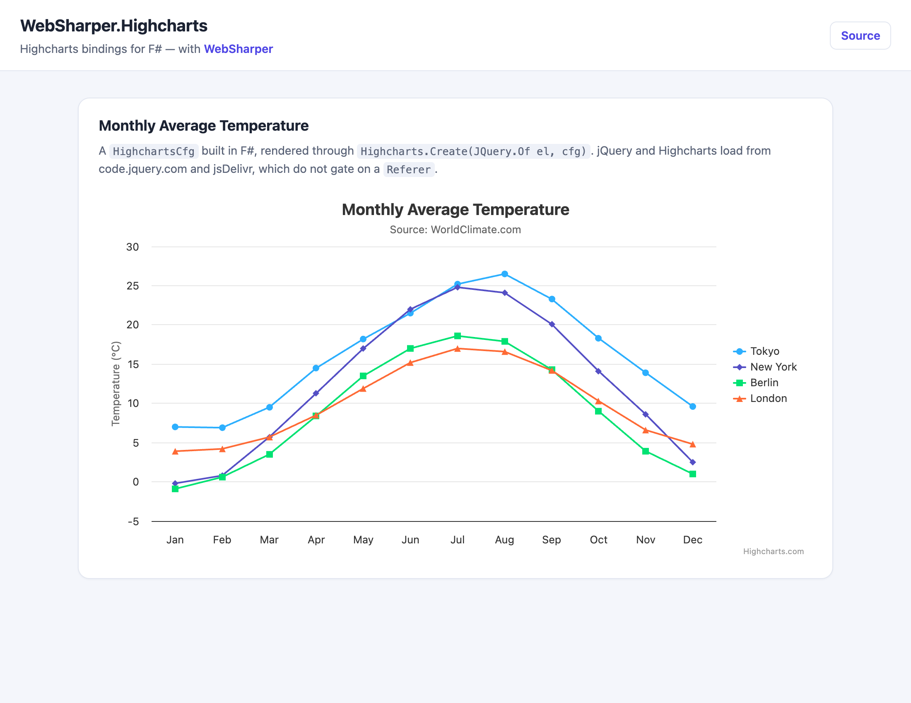

# WebSharper.Highcharts

[](https://www.nuget.org/packages/WebSharper.Highcharts)

[Highcharts][hc] is a JavaScript charting library that produces interactive HTML5
charts from a config object. Highstock extends it with stock/price charts, and
Highmaps adds interactive map charts with drilldown.

The WebSharper bindings for Highcharts provide a strongly typed interface to the
configuration object and helper functions, automatically generated from the
official API documentation ([Highcharts][hcapi], [Highstock][hsapi],
[Highmaps][hmapi]).

This repository contains:

| Project | Purpose |
|---|---|
| `WebSharper.Highcharts` | The binding for Highcharts. |
| `WebSharper.Highstock` | The binding for Highstock. |
| `WebSharper.Highmaps` | The binding for Highmaps. |
| `HighchartsGeneratorCommon` | Generates the bindings from the API definition in `.temp/`. |
| `WebSharper.Highcharts.Sample` | A runnable WebSharper 10 SPA rendering a chart. |

Each binding ships in its own NuGet package.

## Live demos

- **Binding sample (this repo):** https://dotnet-websharper.github.io/highcharts/
- **Sample in the WebSharper samples gallery:** https://websharper-samples.github.io/HighCharts/
- **Sample source in the gallery:** https://github.com/websharper-samples/HighCharts
- **WebSharper:** https://websharper.com



## Loading Highcharts

The bindings declare the Highcharts scripts as resources (`Resources.Highcharts`,
`Resources.Highstock`, `Resources.Highmaps`) which are linked automatically when
you reference the corresponding types. They load from **[jsDelivr][jsd]** —
`https://cdn.jsdelivr.net/npm/highcharts/...` — which does **not** gate on a
`Referer` header. (The previous `code.highcharts.com` URLs returned `403
Missing Referer` when no referer was sent, e.g. in headless browsers or under a
`Referrer-Policy: no-referrer`, and browsers then blocked the response.)

Highcharts integrates with jQuery, so `Resources.Highcharts` also requires the
global jQuery that `WebSharper.JQuery` loads. There is a **single** jQuery
instance: `JQuery.Of(...)` and Highcharts' `$.fn.highcharts` plugin use the same
object, so `Highcharts.Create(JQuery.Of el, cfg)` works.

> If you are on a `WebSharper.JQuery` release older than the fix in
> [dotnet-websharper/jquery#14](https://github.com/dotnet-websharper/jquery/issues/14),
> the binding still `import`s the npm `jquery` module while the resource loads the
> global one, giving two instances. The sample works around this by aliasing the
> `jquery` import to the global (see `WebSharper.Highcharts.Sample/jquery-shim.js`);
> once the fixed `WebSharper.JQuery` is released the shim is simply unused.

## Install

```bash
dotnet add package WebSharper.Highcharts
# or WebSharper.Highstock / WebSharper.Highmaps
```

Or with Paket:

```fsharp
nuget WebSharper.Highcharts
```

The packages target `netstandard2.0` and work with any WebSharper 10 project.

## Usage

```fsharp
open WebSharper
open WebSharper.JavaScript
open WebSharper.JQuery
open WebSharper.Highcharts
open WebSharper.UI
open WebSharper.UI.Html

[<Require(typeof<Resources.Highcharts>)>]
[<JavaScript>]
let Main () =
    div [
        on.afterRender (fun el ->
            Highcharts.Create(JQuery.Of el,
                HighchartsCfg(
                    Title = TitleCfg(Text = "Monthly Average Temperature"),
                    XAxis = [|
                        XAxisCfg(Categories = [| "Jan"; "Feb"; "Mar" |])
                    |],
                    Series = [|
                        SeriesCfg(Name = "Tokyo", Data = As [| 7.0; 6.9; 9.5 |])
                    |]
                )
            ) |> ignore
        )
    ] []
```

Sometimes a config property accepts multiple types, for example an array instead
of a config object. Use WebSharper's `As` helper to cast to the required type; the
cast is erased from the generated JavaScript.

## Notes on the API

- `Highcharts.Create(container, config)` compiles to `$(container).highcharts(config)`;
  the Highstock/Highmaps equivalents call `highcharts('StockChart', ...)` and
  `highcharts('Map', ...)`.
- The full config object is strongly typed: `HighchartsCfg`, `TitleCfg`,
  `XAxisCfg`, `SeriesCfg`, ... are generated from the official API.
- Event handlers, formatters and other callbacks map to F# functions.

## Build from source

### Prerequisites

- [.NET SDK](https://dotnet.microsoft.com/download) 9.0 or later.
- [Node.js](https://nodejs.org/) (LTS) for the esbuild bundle step.
- [Paket](https://fsprojects.github.io/Paket/) as a local dotnet tool (already
  configured in `.config/dotnet-tools.json`).

### Restore and build

```bash
dotnet tool restore
dotnet tool run paket restore
dotnet build WebSharper.Highcharts.sln -c Release
```

The bindings are generated at build time: `WebSharper.Highcharts/Main.fs` reads
the API definition from `.temp/` and builds the assembly through
`HighchartsGeneratorCommon`.

### Run the sample

The sample is a static WebSharper 10 SPA. Building it in Release produces the
self-contained site in `dist/`:

```bash
cd WebSharper.Highcharts.Sample
dotnet build -c Release
# then serve the generated site, e.g.
npx serve ../dist
```

### Pack the NuGet packages

After a Release build:

```bash
dotnet tool run paket pack ./out
```

### Deployment

Pushing to `master` triggers `.github/workflows/ghpages.yml`, which builds the
sample in Release and publishes `dist/` to the `gh-pages` branch via GitHub Pages.

## Repository layout

```
WebSharper.Highcharts/            # Highcharts binding (generated at build)
WebSharper.Highstock/             # Highstock binding
WebSharper.Highmaps/              # Highmaps binding
HighchartsGeneratorCommon/        # shared binding generator
  Definition.fs                   # resource (CDN) definitions + codegen
.temp/                            # API definition consumed by the generator
WebSharper.Highcharts.Sample/     # WS10 SPA sample
  Client.fs
  index.html                      # template (ws-head injection point)
  esbuild.config.mjs
  jquery-shim.js                  # global-jQuery alias for older WebSharper.JQuery
nuget/                            # Paket pack templates
.github/workflows/ghpages.yml     # build + deploy sample to gh-pages
```

## Licensing

For using Highcharts in any public product, acquire a license from
https://shop.highcharts.com/ or, for non-profits, apply for an
Educational/Personal license at https://www.highcharts.com/blog/education/.

The bindings themselves are Apache 2.0 — see [LICENSE.md](LICENSE.md).

[hc]: https://www.highcharts.com/
[hcapi]: https://api.highcharts.com/highcharts
[hsapi]: https://api.highcharts.com/highstock
[hmapi]: https://api.highcharts.com/highmaps
[jsd]: https://www.jsdelivr.com/
