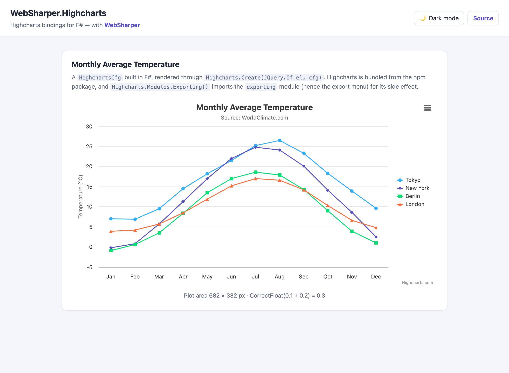

# WebSharper.Highcharts

[](https://www.nuget.org/packages/WebSharper.Highcharts)

[Highcharts][hc] is a JavaScript charting library that produces interactive HTML5
charts from a config object. Highstock extends it with stock/price charts, and
Highmaps adds interactive map charts with drilldown.

The WebSharper bindings for Highcharts provide a strongly typed interface to the
configuration object and helper functions, automatically generated from the
official API documentation ([Highcharts][hcapi], [Highstock][hsapi],
[Highmaps][hmapi]).

This repository contains:

| Project | Purpose |
|---|---|
| `WebSharper.Highcharts` | The binding for Highcharts. |
| `WebSharper.Highstock` | The binding for Highstock. |
| `WebSharper.Highmaps` | The binding for Highmaps. |
| `HighchartsGeneratorCommon` | Generates the bindings from the API definition in `.temp/`. |
| `WebSharper.Highcharts.Sample` | A runnable WebSharper SPA rendering a chart. |

Each binding ships in its own NuGet package.

> **These bindings are Apache 2.0, the libraries are not.** Highcharts,
> Highstock and Highmaps are commercial products of Highsoft AS; the packages
> here contain only the F# bindings and do **not** grant a license for them.
> Commercial use is governed by the [Highsoft Standard License
> Agreement](https://www.highcharts.com/license), non-commercial use by the
> [Highsoft EULA](https://www.highcharts.com/license-eula) — see
> [Licensing](#licensing).

## Live demos

**Try it live:** [Open the sample in your browser](https://dotnet-websharper.github.io/highcharts/)



The sample doubles as the binding's [test case](#running-the-test-case): it renders
a multi-series monthly temperature chart, and the header's theme switch toggles
the light/dark palette and persists the choice in `localStorage`.

- **Sample in the WebSharper samples gallery:** https://websharper-samples.github.io/HighCharts/
- **Sample source in the gallery:** https://github.com/websharper-samples/HighCharts
- **WebSharper:** https://websharper.com

## Loading Highcharts

The bindings are **npm-based**: each imports the ES module build of the npm
package — `highcharts/esm/highcharts.js`, `highcharts/esm/highstock.js`,
`highcharts/esm/highmaps.js` — and the sample bundles it with esbuild. The
`create` helper compiles to `Highcharts.chart(container, config)` (Highcharts),
`Highcharts.stockChart(...)` (Highstock) or `Highcharts.mapChart(...)`
(Highmaps).

### Modules

Most series types (and some option groups, such as the export menu) live in
Highcharts modules that patch the core library and have to be imported for
their side effect. Each binding exposes them through a generated `Modules`
class, and the config classes that need one say so in their documentation:

```fsharp
open WebSharper.Highcharts

// SankeySeriesCfg requires this one; so does the arc-diagram series.
Modules.Sankey()
Modules.Exporting()

Highcharts.Create(container, config) |> ignore
```

The list is generated from the docs, so `Modules.<Name>()` exists exactly for
the modules the option model references (57 for Highcharts, 84 for Highstock,
24 for Highmaps), each backed by an `import "highcharts/esm/modules/…"`.

The sample still uses the jQuery plugin's `WebSharper.JQuery` global instance
(`JQuery.Of`) to pass the container, so the `WebSharper.JQuery` resource is
loaded from the CDN. Highcharts itself is bundled from the npm package, so no
`<script>` tag is emitted for it. Note that pulling in the npm package means
accepting Highsoft's license terms — see [Licensing](#licensing).

## Install

```bash
dotnet add package WebSharper.Highcharts
# or WebSharper.Highstock / WebSharper.Highmaps
```

Or with Paket:

```fsharp
nuget WebSharper.Highcharts
```

The packages target `netstandard2.0` and work with any WebSharper project.

## Usage

```fsharp
open WebSharper
open WebSharper.JavaScript
open WebSharper.JQuery
open WebSharper.Highcharts
open WebSharper.UI
open WebSharper.UI.Html

[<JavaScript>]
let Main () =
    div [
        on.afterRender (fun el ->
            Highcharts.Create(JQuery.Of el,
                HighchartsCfg(
                    Title = TitleCfg(Text = "Monthly Average Temperature"),
                    XAxis = [|
                        XAxisCfg(Categories = [| "Jan"; "Feb"; "Mar" |])
                    |],
                    Series = [|
                        SeriesCfg(Name = "Tokyo", Data = As [| 7.0; 6.9; 9.5 |])
                    |]
                )
            ) |> ignore
        )
    ] []
```

Sometimes a config property accepts multiple types, for example an array instead
of a config object. Use WebSharper's `As` helper to cast to the required type; the
cast is erased from the generated JavaScript.

## Notes on the API

- `Highcharts.Create(container, config)` compiles to
  `Highcharts.chart(container, config)`; the Highstock/Highmaps equivalents call
  `Highcharts.stockChart(...)` and `Highcharts.mapChart(...)`.
- The full config object is strongly typed: `HighchartsCfg`, `TitleCfg`,
  `XAxisCfg`, `SeriesCfg`, ... are generated from the official API.
- Event handlers, formatters and other callbacks map to F# functions.
- Series types are separate config classes (`LineSeriesCfg`, `AreaSeriesCfg`,
  ...). They are flat: each one repeats the options of the series type it is
  derived from, so `LineSeriesCfg()` accepts every `plotOptions.series` option
  plus the line-specific ones.
- Types that the docs share between config objects are exposed once and reused:
  `YAxisCfg.Title` is an `XAxisTitleCfg`, `LineSeriesCfg.Marker` is a
  `PlotOptionsSeriesMarkerCfg`, and so on.
- The runtime classes are bound too: `Highcharts.Create` returns a `Chart` with
  its `Series`, `Axes`, `Renderer`, ... as well as the `Highcharts` namespace
  functions (`Merge`, `CorrectFloat`, `DateFormat`, ...).
- A config that needs a Highcharts module says so in its doc comment and names
  the `Modules` member to call — see [Modules](#modules).

## Regenerating the API model

`.temp/*.json` is generated from the Highcharts documentation for the release
the bindings target (they are pinned to `highcharts` 13.x on npm):

```bash
python3 tools/api-gen/gen_configs.py   # options: *configs.json
python3 tools/api-gen/gen_objects.py   # runtime classes: *objects.json
```

Both scripts fetch from `api.highcharts.com` and write into `.temp/`; see
[`tools/api-gen/README.md`](tools/api-gen/README.md) for details. The bindings
are compiled from these files, so re-run a build afterwards (an *incremental*
build will not notice the change — touch `WebSharper.Highcharts/Main.fs` first,
or rebuild the binding projects).
## Running the test case

The sample is a static WebSharper SPA. Build it in Release to produce the
self-contained site in `dist/`:

```bash
cd WebSharper.Highcharts.Sample
dotnet build -c Release
```

Then serve it with [`dotnet-serve`](https://github.com/dotnet-serve/dotnet-serve)
(install it once with `dotnet tool install -g dotnet-serve`):

```bash
dotnet serve -d ../dist -p 8080
```

Open http://localhost:8080/ to see the chart. The header's theme switch toggles
the light/dark palette.

## Build from source

### Prerequisites

- [.NET SDK](https://dotnet.microsoft.com/download) 10.0 or later.
- [Node.js](https://nodejs.org/) (LTS) for the esbuild bundle step.
- [Paket](https://fsprojects.github.io/Paket/) as a local dotnet tool (already
  configured in `.config/dotnet-tools.json`).

### Restore and build

```bash
dotnet tool restore
dotnet paket restore
dotnet build WebSharper.Highcharts.sln -c Release
```

The bindings are generated at build time: `WebSharper.Highcharts/Main.fs` reads
the API definition from `.temp/` and builds the assembly through
`HighchartsGeneratorCommon`.

### Pack the NuGet packages

```bash
dotnet paket pack ./out
```

### Deployment

Pushing to `master` triggers `.github/workflows/ghpages.yml`, which builds the
sample in Release and publishes `dist/` to the `gh-pages` branch via GitHub Pages.

## Repository layout

```
WebSharper.Highcharts/            # Highcharts binding (generated at build)
WebSharper.Highstock/             # Highstock binding
WebSharper.Highmaps/              # Highmaps binding
HighchartsGeneratorCommon/        # shared binding generator
  Definition.fs                   # npm module names + codegen
.temp/                            # API definition consumed by the generator
tools/api-gen/                    # regenerates .temp/ from the Highcharts docs
WebSharper.Highcharts.Sample/     # SPA sample
  Client.fs
  index.html                      # template (ws-head injection point)
  esbuild.config.mjs
  jquery-shim.js                  # global-jQuery alias for older WebSharper.JQuery
nuget/                            # Paket pack templates
.github/workflows/ghpages.yml     # build + deploy sample to gh-pages
```

## Licensing

**Highcharts, Highstock and Highmaps are commercial libraries and are not free
for every use.** They are the property of Highsoft AS, and any application that
renders one of their charts is subject to Highsoft's terms:

| Use | Licence |
|---|---|
| Commercial | [Highsoft Standard License Agreement](https://www.highcharts.com/license) — buy at https://shop.highcharts.com/ |
| Non-commercial | [Highsoft End-User License Agreement (EULA)](https://www.highcharts.com/license-eula) |
| Education / non-profit | apply for an Educational or Personal license at https://www.highcharts.com/blog/education/ |

The authoritative text is the one that ships with the library
(`node_modules/highcharts/LICENSE.txt`) and on
https://www.highcharts.com/license; the links above are the license pages
themselves.

The NuGet packages in this repository contain **only the WebSharper bindings**.
They are Apache 2.0 — see [LICENSE.md](LICENSE.md) — and they do not bundle or
sublicense Highcharts: the sample (and your application) pulls the library from
the `highcharts` npm package, so the terms above apply to *that* dependency, not
to the bindings.

[hc]: https://www.highcharts.com/
[hcapi]: https://api.highcharts.com/highcharts
[hsapi]: https://api.highcharts.com/highstock
[hmapi]: https://api.highcharts.com/highmaps
